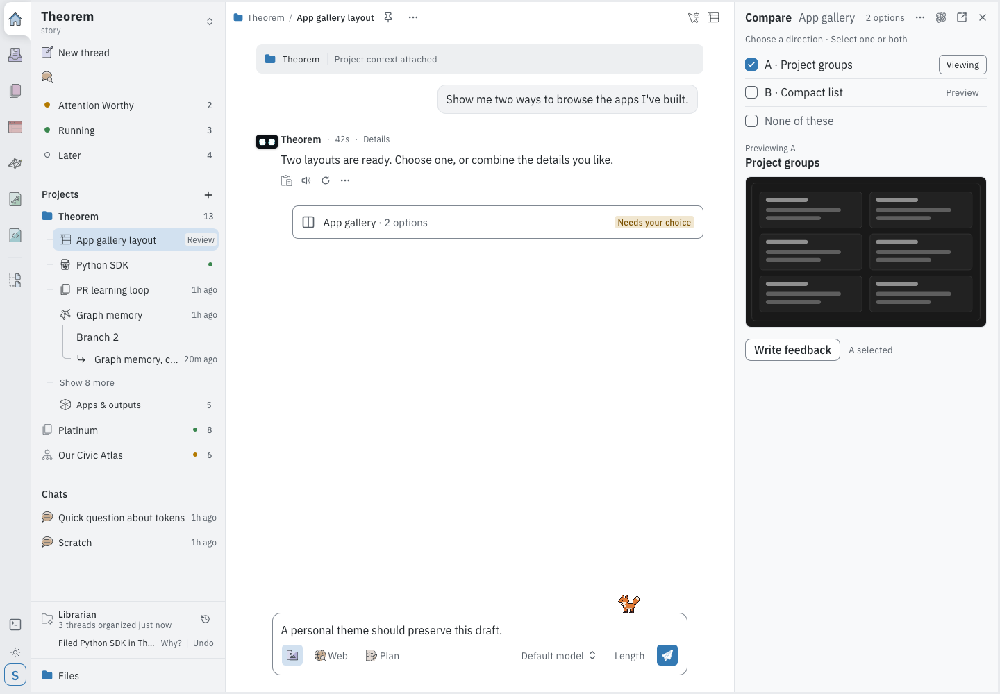
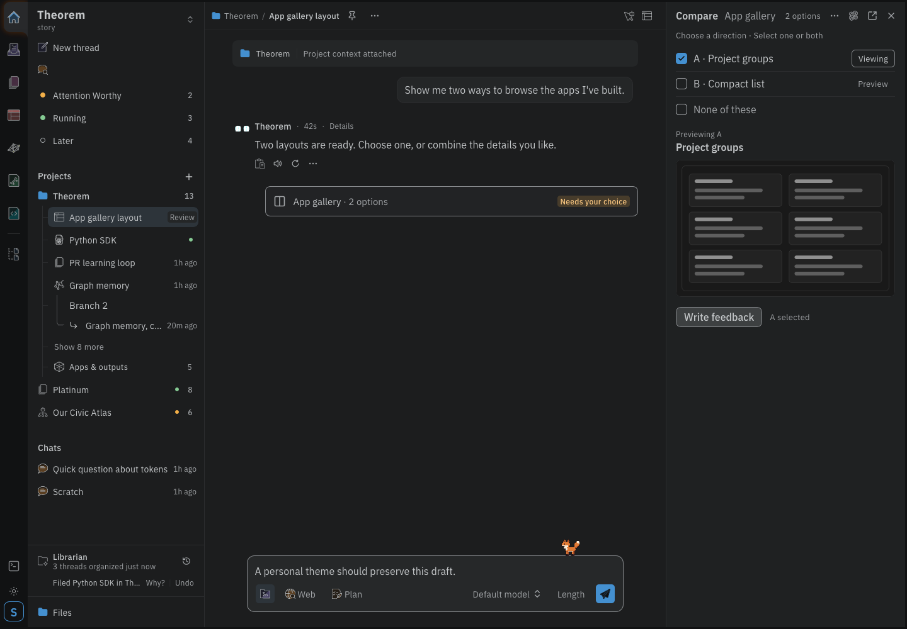
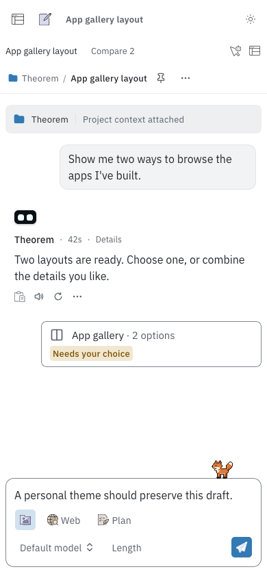
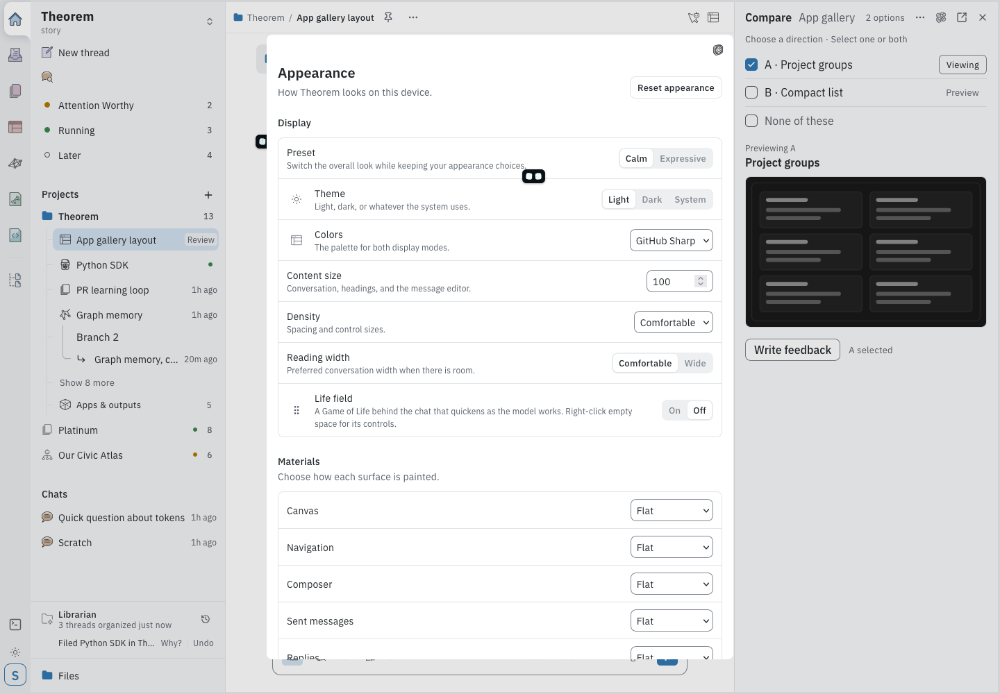
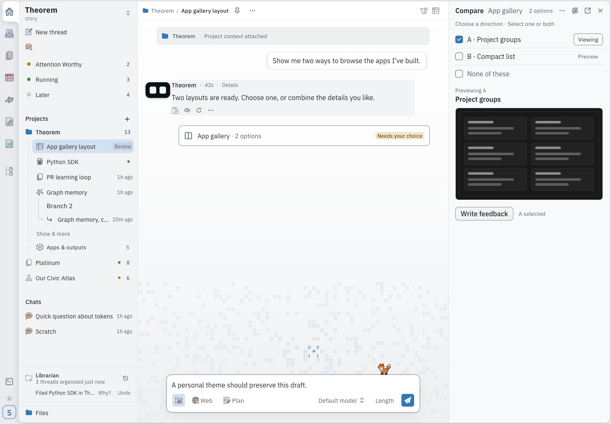

# Redesign screenshots

Captured in Firefox 157.0 from the local `shell-compare` demonstration fixture. These use the implemented components with sample conversation data.

## Calm light — desktop

1440 × 1000 CSS pixels.

## Calm dark — desktop

1440 × 1000 CSS pixels.

## Calm light — narrow layout

390 × 844 CSS pixels.

## Appearance controls

1440 × 1000 CSS pixels.

## Expressive preset

1440 × 1000 CSS pixels.

